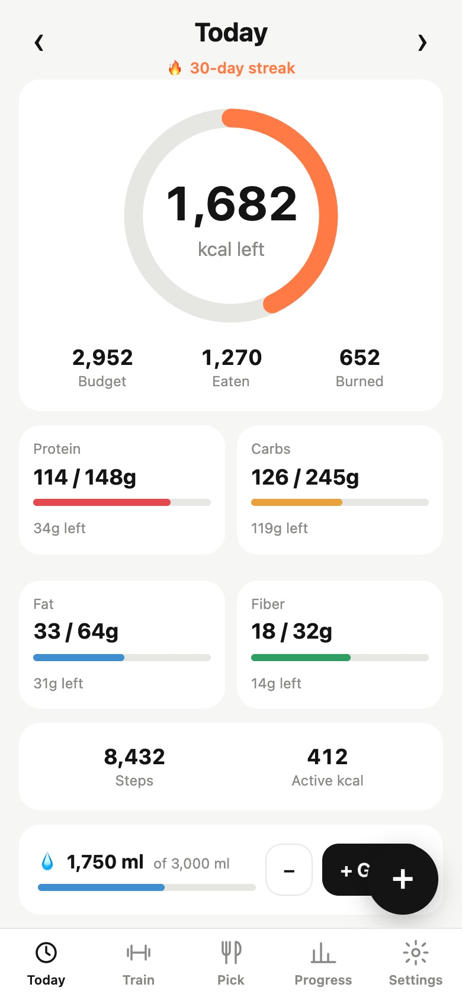
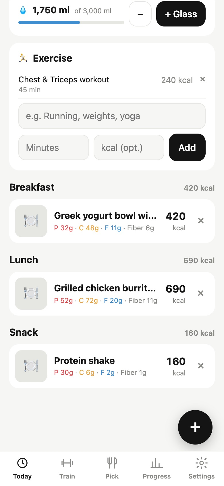
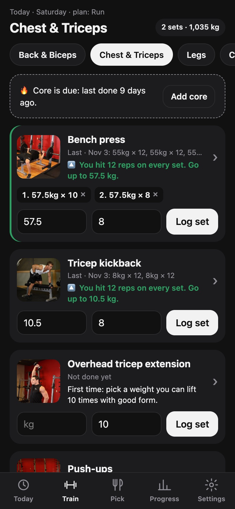
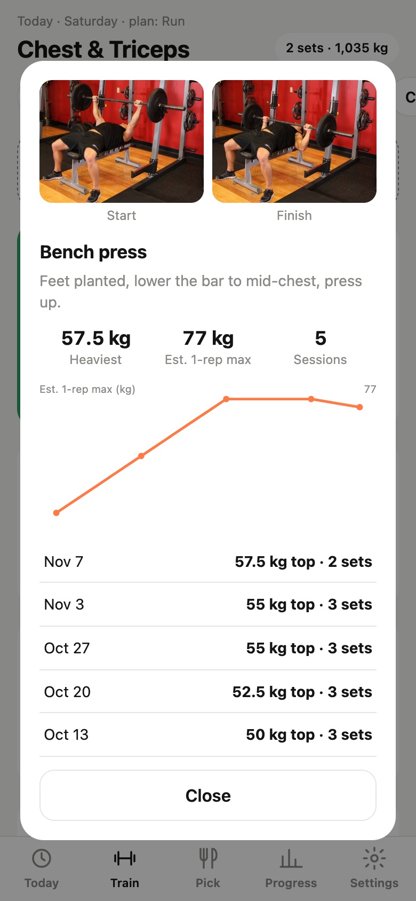
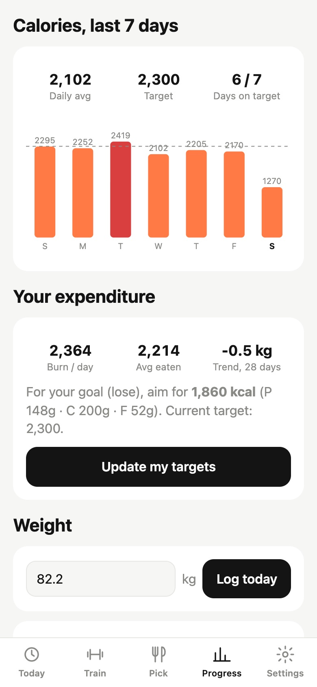

# CalSnap

**A personal, self-hosted nutrition and workout tracker for iPhone.** Snap a photo of your food and get
calories, protein, carbs, fat and fiber in about 2 seconds. Then track your daily budget, workouts, weight
and Apple Watch activity, all in one home-screen app you host yourself, for free.

It combines the photo logging of apps like Cal AI with MacroFactor-style adaptive targets and a simple
progressive-overload workout log. Food recognition uses Google's Gemini models (free tier). Everything
runs on Cloudflare's free plan, and your data lives in your own database.

<p align="center">
  
  
  
  
  
</p>

<p align="center"><sub>Screenshots use demo data.</sub></p>

## Features

**Food**
- **Photo logging:** take photos with the in-app camera or pick several from your library. Gemini identifies
  each food, estimates the portion and returns calories, protein, carbs, fat and fiber.
- **Text and barcode logging:** describe a meal ("2 eggs, toast with butter") or scan a packaged food's
  barcode. Label data comes from [Open Food Facts](https://world.openfoodfacts.org).
- **Fix it:** correct an estimate in plain words ("it was 2 eggs, not 3") and Gemini re-estimates it, or
  tap × to remove a food it got wrong.
- **Breakfast, lunch, dinner and snack:** each meal is sorted automatically from the food and the time
  you log it.
- **Favorites and recent meals:** log a meal you eat often with one tap. Every meal can be edited.
- **Macro sources:** tap Protein (or Carbs, Fat or Fiber) to see which foods gave you the most today.
- **Food picker:** list what's in your fridge and get 2 tasty meal ideas that fit your remaining calories
  and protein.

**Budget and progress**
- Daily calorie ring with protein, carbs, fat and fiber bars, plus a streak and water tracking.
- Targets calculated from your height, weight, age and activity (Mifflin-St Jeor formula).
- 7-day calorie chart, plus a weight chart with a smoothed trend line that hides daily water swings.
- **Adaptive targets:** after 2 weeks, CalSnap works out how many calories you *actually* burn from what you
  ate and how your weight changed, then suggests new targets.

**Workouts**
- A weekly split (Back & Biceps, Chest & Triceps, Legs, Run). The Train tab opens on that day's workout,
  and suggests core when you haven't done it for a while.
- Around 37 exercises. Your own routine is listed first, then optional extras for variety.
- Each exercise shows the muscles it targets, an animated start-to-finish demo, form tips, step-by-step
  instructions and a link to how-to videos.
- Log weight × reps, bodyweight reps, timed holds (plank) or runs (distance and time).
- **Progressive overload:** each exercise shows a target based on last session. Once you hit 12 reps on
  every set, it tells you to add weight.
- Personal records, an estimated one-rep max, and a progress chart for each exercise.
- Finishing a workout logs its calories, estimated by Gemini, toward the day's "Burned" total.

**Apple Watch / Apple Health:** steps, active calories and weight can sync through an iOS Shortcut (see
below). Burned calories can optionally add to your daily budget.

**Other:** one-tap light/dark switch in the top bar, or match your iPhone's setting in Settings. Units in kg/cm/ml or lb/in/oz.

## How it works

```
iPhone (home-screen web app) ──► Cloudflare Pages   /         static app (public/)
iOS Shortcut (Health data) ───►                     /api/*    Pages Function (functions/api/[[path]].js)
                                                     │
                                                     ├─► Cloudflare D1 (SQLite): meals, weights, sets, …
                                                     ├─► Gemini API: photo/text → nutrition JSON
                                                     └─► Open Food Facts: barcode lookups
```

- The app is plain HTML, CSS and JavaScript, with no build step or framework.
- Your Gemini API key is stored only as a Cloudflare secret. It is never sent to the phone or committed to
  the repo.
- Every API call needs your **access code** (`APP_TOKEN`), so nobody else can read your data or use your
  Gemini quota.
- When one Gemini model is rate limited or overloaded, the next model in the list is tried automatically
  (free-tier limits are per model).

## Run your own copy

You need:
- [Node.js](https://nodejs.org) 20 or newer
- A free [Cloudflare account](https://dash.cloudflare.com/sign-up)
- A free [Gemini API key](https://aistudio.google.com/apikey): click **Create API key**.

Note: on Gemini's free tier, Google may use your requests to improve its products. Add billing in AI
Studio if you don't want that.

### 1. Clone and install

```bash
git clone https://github.com/AjayKumarGogineni777/calsnap.git
cd calsnap
npm install
npx wrangler login            # opens your browser once to connect your Cloudflare account
```

### 2. Create the database

```bash
npx wrangler d1 create calsnap
```

This prints a `database_id`. Paste it into `wrangler.toml` in place of the existing one, then create
the tables:

```bash
npm run db:remote
```

### 3. Create the site and add your secrets

```bash
npx wrangler pages project create calsnap --production-branch main
npx wrangler pages secret put GEMINI_API_KEY --project-name calsnap
npx wrangler pages secret put APP_TOKEN --project-name calsnap
```

Each `secret put` asks you to paste the value at a hidden prompt, so it never appears in your shell
history. For `APP_TOKEN`, use any long random string; this becomes your access code. You can generate one
with `openssl rand -hex 16`.

If `calsnap` is already taken as a project name, pick another and use it in every command.

### 4. Deploy

```bash
npm run deploy
```

This prints your URL, for example `https://calsnap-xxx.pages.dev`. Run it again after any change.

### 5. Install on your iPhone

1. Open your URL in **Safari**.
2. Tap **Share** → **Add to Home Screen**.
3. Open CalSnap from the home screen and enter your access code.
4. In **Settings**, fill in your details, tap **Calculate targets**, then **Save**.

### 6. Optional: sync Apple Watch / Health data

A web app can't read Apple Health directly, so an iOS Shortcut sends the numbers instead. In the
**Shortcuts** app, tap **+** and add these actions in order:

1. **Find Health Samples**: *Type* Steps, *Start Date* is today. Then **Calculate Statistics** → *Sum*.
   Rename the result `Steps`.
2. **Find Health Samples**: *Type* Active Energy, *Start Date* is today. Then **Calculate Statistics** →
   *Sum*. Rename it `Active`.
3. **Find Health Samples**: *Type* Weight, sorted by *Start Date* (Latest First), *Limit* 1. Then **Get
   Details of Health Sample** → *Value*. Rename it `Weight`. It's sent in your app's unit (kg or lb).
4. **Format Date**: *Current Date*, custom format `yyyy-MM-dd`.
5. **Get Contents of URL**:
   - URL: `https://YOUR-SITE.pages.dev/api/health`
   - Method: **POST**
   - Headers: `Authorization` = `Bearer YOUR_ACCESS_CODE`
   - Request Body: **JSON** with `date` = Formatted Date, `steps` = Steps, `active_kcal` = Active,
     `weight` = Weight

Run it once by hand and allow Health access. Then go to **Automation** → **+** → **Time of Day** →
hourly → **Run Immediately**, and choose this shortcut.

To let burned calories raise your budget, turn on **Settings → Add burned calories to my budget**.

## Local development

```bash
cp .dev.vars.example .dev.vars    # put your Gemini key in it; APP_TOKEN=devtoken is the local access code
npm run db:local                  # creates the tables in a local database
npm run dev                       # http://localhost:8788
```

`.dev.vars` is git-ignored, so your key stays on your machine.

## Customizing

- **Workout plan and exercises:** edit `public/exercises.js`. `SCHEDULE` sets the group for each day of
  the week; `EXERCISES` holds names, types and form tips.
- **AI models:** edit `MODELS` at the top of `functions/api/[[path]].js`. They're tried in order.
- **Targets formula:** `calcTargets` in `public/app.js`. Protein is 1.8 g per kg of body weight, fat is
  25 % of calories, and carbs are the rest. Every number can also be edited in the app.

## Upgrading an existing database

Databases created with an older version need the matching migration files, run once in order:

```bash
npx wrangler d1 execute calsnap --remote --file=migrate-v2.sql   # favorites, water
npx wrangler d1 execute calsnap --remote --file=migrate-v3.sql   # fiber, exercise
npx wrangler d1 execute calsnap --remote --file=migrate-v4.sql   # workouts, meal types
```

If `--file` gives an authentication error, paste the file's SQL using `--command "..."` instead. A new
database created from `schema.sql` already has everything.

## Notes and limitations

- **Accuracy:** AI estimates can be off by 20 % or more, especially for oils, sauces and portion sizes.
  Check them before saving, and add details the photo can't show ("cooked in 1 tbsp butter").
- **Photos:** photos are shrunk on the phone to 1024 px before upload. Only a 200 px thumbnail is stored.
- **Storage:** data is kept until you delete it. D1's free 5 GB holds hundreds of thousands of meals.
- **Camera:** on some iPhones, the camera doesn't work inside home-screen web apps. Use **Library** with
  photos from the regular Camera app instead.
- **Credits:** exercise pictures, target muscles and instructions are from [Free Exercise DB](https://github.com/yuhonas/free-exercise-db),
  which is public domain. Barcode data is from [Open Food Facts](https://world.openfoodfacts.org) (ODbL).
